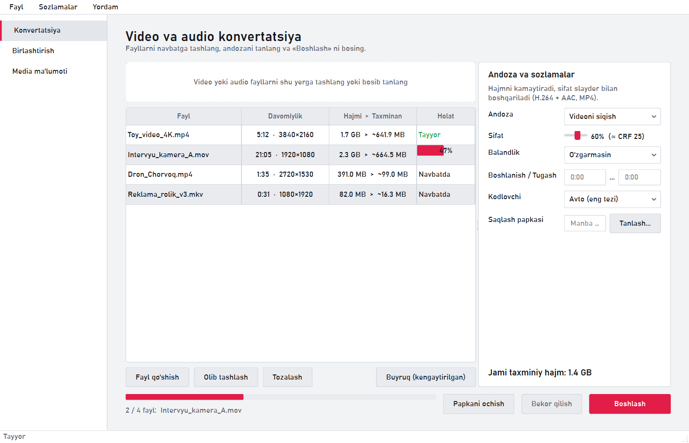
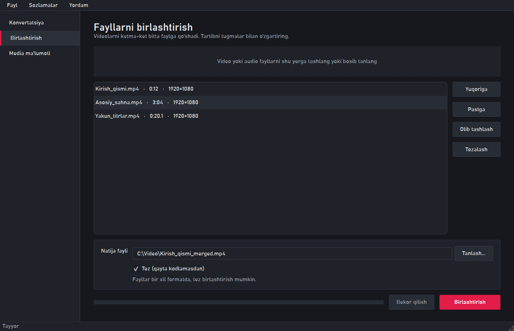
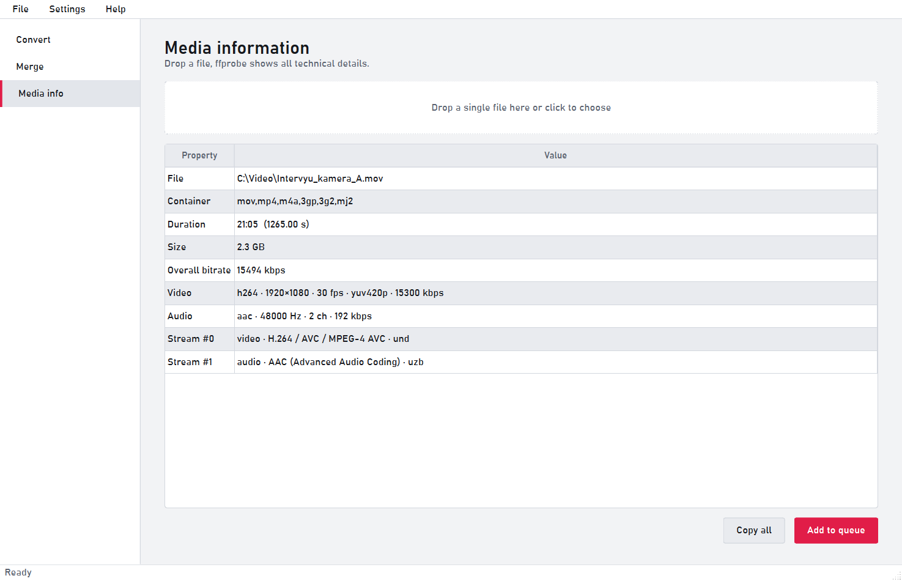

<h1 align="center">FFmpeg qobig'i</h1>

<b>FFmpeg Shell</b> · Оболочка FFmpeg

   
  
  
  
  

FFmpeg uchun qulay oyna: videoni siqish, Telegram, Instagram Reels, YouTube va WhatsApp uchun tayyorlash, formatni o'zgartirish, ovozni ajratish, GIF, kesish, burish, birlashtirish va kadrlarni olish. Navbat, jarayon foizi va taxminiy hajm bilan. To'liq offline.

## Imkoniyatlar

- 13 ta tayyor andoza: siqish, Telegram (≤2 GB), Reels 1080×1920, YouTube 1080p, WhatsApp va boshqalar
- Sudrab-tashlash navbati, har bir fayl uchun jarayon foizi va bekor qilish
- Chiqish faylining taxminiy hajmi oldindan ko'rsatiladi
- Apparat kodlovchini (NVIDIA / AMD / Intel) avtomatik aniqlaydi
- GIF (sifatli palitra), kesish, burish, o'lcham, ovozsiz qilish, kadrlarni olish
- Videolarni birlashtirish (tez yoki qayta kodlab)
- ffprobe media ma'lumoti paneli
- Kengaytirilgan rejim: ffmpeg buyrug'ini ko'rish va tahrirlash
- O'zbek, rus, ingliz tillari; yorug' va qorong'i mavzu

## Texnik ma'lumot

- Video kodlash: H.264 (NVENC / AMF / QSV / Media Foundation / OpenH264), VP9, MPEG-4; audio: AAC, MP3, Opus, PCM.
- Jarayon foizi `ffmpeg -progress pipe:1` orqali o'qiladi.
- Manba koddan yig'ish uchun `ffmpeg.exe`, `ffprobe.exe` va `LICENSE.txt` ni `vendor/ffmpeg/` papkasiga qo'ying (LGPL build), so'ng `python build.py .`.

## O'rnatish

1. [**FFmpegQobigi-1.0.0-portable.zip**](https://github.com/eduhakimov/video-konvertor/releases/latest/download/FFmpegQobigi-1.0.0-portable.zip) faylini yuklab oling.
2. Arxivni ochib, ichidagi FFmpegQobigi.exe ni ishga tushiring.
3. Windows SmartScreen ogohlantirsa: **Batafsil → Baribir ishga tushirish**.

**Tizim talablari:** Windows 10 (1809+) / Windows 11, x64

---

## Русский

Удобная оболочка FFmpeg: сжатие видео, подготовка для Telegram, Instagram Reels, YouTube и WhatsApp, смена формата, извлечение звука, GIF, обрезка, поворот, склейка и извлечение кадров. Очередь, процент выполнения и оценка размера. Полностью офлайн.

- 13 готовых шаблонов: сжатие, Telegram (≤2 ГБ), Reels 1080×1920, YouTube 1080p, WhatsApp и др.
- Очередь с перетаскиванием, процент для каждого файла и отмена
- Оценка размера результата заранее
- Автоматически находит аппаратный кодировщик (NVIDIA / AMD / Intel)
- GIF с палитрой, обрезка, поворот, разрешение, удаление звука, извлечение кадров
- Склейка видео (быстро или с перекодированием)
- Панель сведений ffprobe
- Расширенный режим: просмотр и правка команды ffmpeg
- Узбекский, русский, английский; светлая и тёмная тема

## English

A desktop front-end for FFmpeg: compress video, prepare it for Telegram, Instagram Reels, YouTube and WhatsApp, change format, extract audio, make GIFs, trim, rotate, merge and extract frames. Batch queue, live progress and size estimates. Works offline.

- 13 ready presets: compress, Telegram (≤2 GB), Reels 1080×1920, YouTube 1080p, WhatsApp and more
- Drag & drop batch queue with per-file progress and cancel
- Estimated output size shown in advance
- Detects hardware encoders (NVIDIA / AMD / Intel) automatically
- Palette GIF, trim, rotate, resize, remove audio, extract frames
- Merge videos (fast copy or re-encode)
- ffprobe media info panel
- Advanced mode: view and edit the ffmpeg command
- Uzbek, Russian, English; light and dark themes

---

## Muallif / Author

**Bahtiyorjon Hakimov** (Hakimov Bahtiyorjon Muzaffar o'g'li) — [github.com/eduhakimov](https://github.com/eduhakimov)

© 2026 Bahtiyorjon Hakimov. Barcha huquqlar himoyalangan. / Все права защищены. / All rights reserved.
Batafsil: [LICENSE](LICENSE) · Uchinchi tomon komponentlari: [THIRD_PARTY_NOTICES.md](THIRD_PARTY_NOTICES.md)
