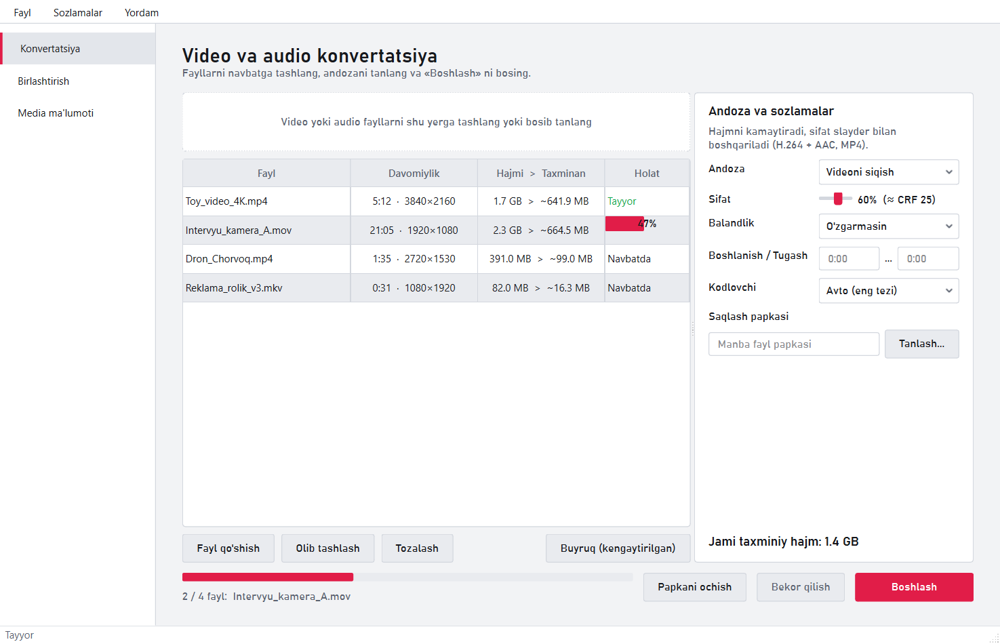
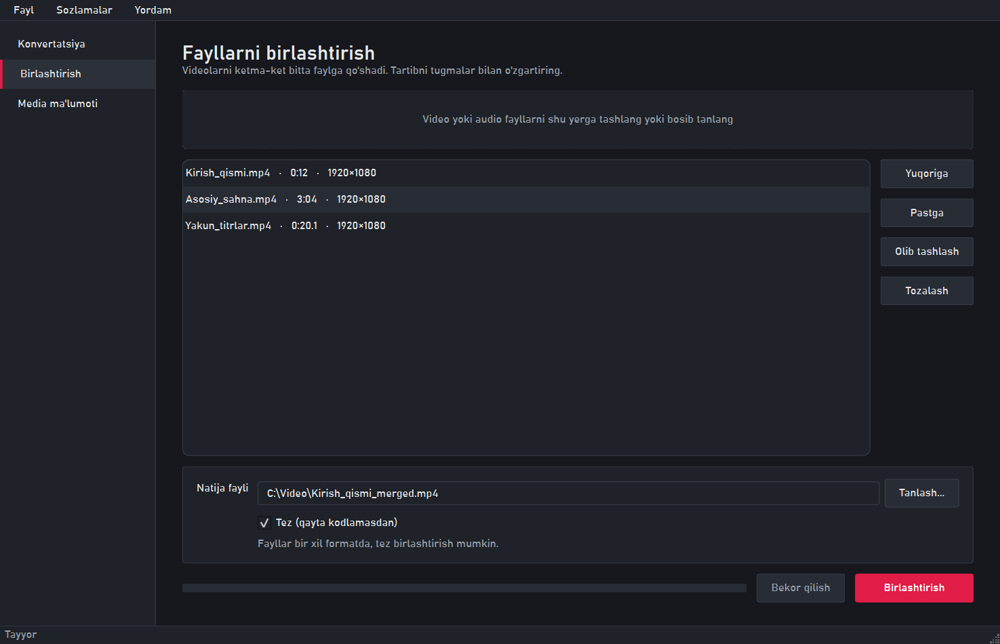
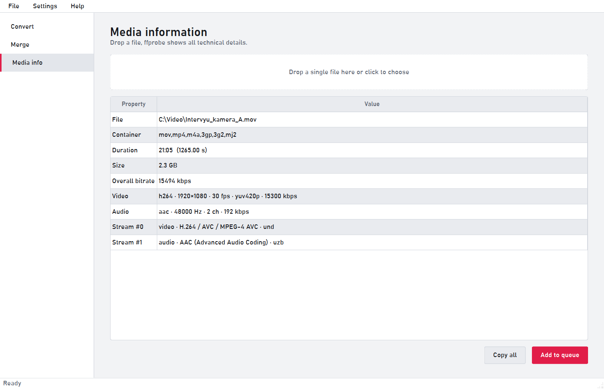

# FFmpeg qobig‘i: Foydalanish qo‘llanmasi

Muallif: Hakimov Bahtiyorjon. Versiya: 1.0.2.

## 1. Umumiy ma’lumot

“FFmpeg qobig‘i” – video va audio fayllar bilan ishlash uchun qulay oyna. Dastur FFmpeg yordamida videoni siqadi, uni Telegram, Instagram Reels, YouTube va WhatsApp uchun tayyorlaydi, formatini o‘zgartiradi, ovozini ajratadi, GIF yasaydi, kesadi, buradi, videolarni birlashtiradi va kadrlarni rasm sifatida saqlaydi. Har bir fayl uchun jarayon foizi va natijaning taxminiy hajmi ko‘rsatiladi.

Dastur o‘qituvchilar, talabalar, blogerlar, jurnalistlar va video materiallarni turli platformalarga tayyorlashi kerak bo‘lgan har qanday foydalanuvchi uchun mo‘ljallangan. Buyruq satrini bilish talab qilinmaydi. Barcha amallar kompyuterda bajariladi, internet kerak emas.

Qo‘llanmada tugma va bo‘lim nomlari dasturning o‘zbekcha interfeysidagi kabi keltirilgan.

Dasturda uchta sahifa bor: “Konvertatsiya” – fayllarni tanlangan andoza bo‘yicha qayta ishlash; “Birlashtirish” – bir nechta videoni bitta faylga qo‘shish; “Media ma’lumoti” – fayl haqidagi texnik ma’lumotlarni ko‘rish.

## 2. Tizim talablari

- Operatsion tizim: Windows 10 (1809 va undan yuqori) yoki Windows 11, 64 bitli.
- Internet: talab qilinmaydi. FFmpeg va FFprobe dastur bilan birga keladi.
- Videokarta: shart emas. NVIDIA, AMD yoki Intel videokartasining apparat kodlovchisi mavjud bo‘lsa, dastur undan avtomatik foydalanadi.
- Diskda bo‘sh joy: yaratiladigan natija fayllari uchun (taxminiy hajm dasturda oldindan ko‘rsatiladi).
Qo‘llab-quvvatlanadigan kiruvchi fayllar: FFmpeg o‘qiy oladigan keng tarqalgan video va audio formatlari (masalan, MP4, MKV, MOV, AVI, WEBM, MP3, WAV). Chiqish formatlari: MP4, MKV, MOV, WEBM, AVI, MP3, M4A, WAV, GIF, JPG va PNG.

## 3. O‘rnatish va ishga tushirish

1. Dasturning GitHub sahifasidagi (https://github.com/eduhakimov/video-konvertor) “Releases” bo‘limidan portativ ZIP arxivni yuklab oling.
2. Arxivni qulay papkaga to‘liq oching. Dastur fayli va ffmpeg papkasi birga turishi kerak.
3. Arxivdan chiqarilgan FFmpegQobigi.exe faylini ishga tushiring. O‘rnatish talab qilinmaydi.
4. Windows SmartScreen ogohlantirish chiqarsa, “Batafsil” havolasini, so‘ng “Baribir ishga tushirish” tugmasini bosing.
Birinchi kodlashda dastur kompyuterdagi apparat kodlovchilarni tekshiradi; bu bir necha soniya vaqt olishi mumkin. Natija eslab qolinadi va keyingi kodlashlar tezroq boshlanadi.

## 4. Dastur oynasi bilan tanishish

Oynaning yuqorisida menyu satri (“Fayl”, “Sozlamalar”, “Yordam”), chap tomonda uchta sahifa nomi joylashgan: “Konvertatsiya”, “Birlashtirish” va “Media ma’lumoti”.

“Konvertatsiya” sahifasida yuqorida fayllarni tashlash maydoni, uning ostida navbat jadvali, o‘ng tomonda “Andoza va sozlamalar” kartochkasi joylashgan. Jadval ostida “Fayl qo‘shish”, “Olib tashlash”, “Tozalash” va “Buyruq (kengaytirilgan)” tugmalari, eng pastda umumiy jarayon chizig‘i, “Papkani ochish”, “Bekor qilish” va “Boshlash” tugmalari bor. Kartochka pastida “Jami taxminiy hajm” ko‘rsatiladi.

Navbat jadvalida har bir fayl uchun nomi, davomiyligi va o‘lchami, hajmi va natijaning taxminiy hajmi (“Hajmi > Taxminan”), jarayon va holat ko‘rinadi.

“Birlashtirish” sahifasida fayllar ro‘yxati, o‘ng tomonda “Yuqoriga”, “Pastga”, “Olib tashlash” va “Tozalash” tugmalari, pastda “Natija fayli” maydoni, “Tez (qayta kodlamasdan)” belgisi va “Birlashtirish” tugmasi joylashgan. “Media ma’lumoti” sahifasida “Xususiyat” va “Qiymat” ustunli jadval hamda “Hammasini nusxalash” va “Navbatga qo‘shish” tugmalari bor.

Navbat jadvali va sozlamalar kartochkasi orasidagi chegarani sudrab, ularning kengligini o‘zgartirish mumkin. Pastki holat satrida dastur holati haqida qisqa xabarlar chiqadi.

*1-rasm. “Konvertatsiya” sahifasi: navbat jadvali, andoza sozlamalari va jarayon*

## 5. Asosiy amallar

Quyida dasturning har bir sahifasi va andozasi bilan ishlash tartibi tavsiflangan. Odatiy ish tartibi: fayllarni navbatga qo‘shish – andozani tanlash – sozlamalarni tekshirish – “Boshlash” tugmasini bosish – natijani ko‘rish.

**Fayllarni konvertatsiya qilish.**

1. “Konvertatsiya” sahifasini oching.
2. Video yoki audio fayllarni tashlash maydoniga sudrab tashlang yoki “Fayl qo‘shish” tugmasini bosing. Dastur har bir faylni o‘qib, davomiylik, o‘lcham va hajmni jadvalda ko‘rsatadi.
3. “Andoza” ro‘yxatidan kerakli vazifani tanlang. Ro‘yxat ostida andoza tavsifi chiqadi.
4. Andozaga xos parametrlarni sozlang (masalan, “Sifat” slayderi yoki “Format”). “Taxminan” ustunida natija hajmi darhol yangilanadi.
5. Kerak bo‘lsa, “Saqlash papkasi” ni tanlang (bo‘sh bo‘lsa, natija manba fayl papkasiga yoziladi).
6. “Boshlash” tugmasini bosing. Fayllar navbat bilan qayta ishlanadi. To‘xtatish uchun “Bekor qilish” tugmasini bosing.
7. Tugagach, “Papkani ochish” tugmasi orqali natijalarni ko‘ring.
**Andozalar va ularning sozlamalari.**

- “Videoni siqish” – “Sifat” slayderi bilan hajm va sifat muvozanatini tanlang; kerak bo‘lsa “Balandlik” ni kamaytiring.
- “Telegram uchun” – 1080p gacha, natija 2 GB dan oshmaydi.
- “Instagram Reels (1080×1920)” – vertikal video; gorizontal video uchun “Joylash” usulini tanlang: “Xira fon bilan”, “Qora hoshiya” yoki “Kesib to‘ldirish”.
- “YouTube 1080p” – 1920×1080 o‘lcham, sifatli ovoz.
- “WhatsApp uchun” – 720p, 30 kadr/s, kichik hajm.
- “Formatni o‘zgartirish” – MP4, MKV, MOV, WEBM yoki AVI; “Tez (qayta kodlamasdan)” belgisi yoqilsa, video qayta kodlanmaydi va jarayon juda tez bajariladi.
- “Ovozni ajratib olish” – MP3, AAC (M4A) yoki WAV; MP3 va AAC uchun “Bitreyt” ni tanlang.
- “GIF yasash” – “Kadr/s” va “Kenglik (px)” ni tanlang; qisqa bo‘lak uchun “Boshlanish / Tugash” vaqtini kiriting.
- “Kesib olish” – “Boshlanish” va “Tugash” vaqtini kiriting, masalan “1:30” yoki “90”.
- “O‘lchamni o‘zgartirish” – kerakli “Balandlik” ni tanlang, proporsiya saqlanadi.
- “Burish / aks ettirish” – “Amal” ro‘yxatidan burish yoki aks ettirish turini tanlang.
- “Ovozni olib tashlash” – video qayta kodlanmaydi.
- “Kadrlarni rasmga olish” – “Har N soniyada” va “Rasm formati” (JPG yoki PNG) ni tanlang; rasmlar alohida papkaga saqlanadi.
Vaqt maydonlariga “90”, “1:30” yoki “00:01:30.5” ko‘rinishida yozish mumkin. Bo‘sh qoldirilsa, butun fayl qayta ishlanadi.

**Videolarni birlashtirish.**

1. “Birlashtirish” sahifasini oching va kamida ikkita faylni qo‘shing.
2. Tartibni “Yuqoriga” va “Pastga” tugmalari bilan o‘zgartiring.
3. “Natija fayli” maydonida yangi fayl nomini tekshiring.
4. Dastur fayllar bir xil formatda ekanini aniqlasa, “Tez (qayta kodlamasdan)” rejimi tavsiya etiladi; aks holda fayllar qayta kodlanadi va bu ko‘proq vaqt oladi.
5. “Birlashtirish” tugmasini bosing.
**Media ma’lumotini ko‘rish.** “Media ma’lumoti” sahifasiga bitta faylni tashlang. Jadvalda konteyner, davomiylik, hajm, bitreyt, video va audio parametrlari chiqadi. “Hammasini nusxalash” tugmasi ma’lumotni nusxalaydi, “Navbatga qo‘shish” esa faylni konvertatsiya navbatiga qo‘shadi.

**Buyruqni ko‘rish va tahrirlash (tajribali foydalanuvchilar uchun).** Navbatdan faylni tanlab, “Buyruq (kengaytirilgan)” tugmasini bosing. Oynada shu fayl uchun tuzilgan buyruq chiqadi. Uni tahrirlab, “Shu faylga qo‘llash” tugmasini bosing yoki “Asl holiga qaytarish” orqali dastlabki buyruqqa qayting.

**Andoza tanlash bo‘yicha maslahatlar.**

- Videoni messenjer orqali yuborish kerak bo‘lsa, “Telegram uchun” yoki “WhatsApp uchun” andozasini tanlang: ular platforma cheklovlarini o‘zi hisobga oladi.
- Videoni faqat boshqa formatga o‘tkazish kerak bo‘lsa, avval “Formatni o‘zgartirish” andozasida “Tez (qayta kodlamasdan)” rejimini sinab ko‘ring: bu eng tez usul va sifat o‘zgarmaydi.
- Hajmni kamaytirish kerak bo‘lsa, “Videoni siqish” andozasida avval sifatni 60% atrofida qoldirib, natijani tekshiring; hajm hali katta bo‘lsa, sifatni pasaytiring yoki “Balandlik” ni kamaytiring.
- Ma’ruza yoki intervyudan faqat ovoz kerak bo‘lsa, “Ovozni ajratib olish” andozasidan foydalaning: audio fayl videodan ancha kichik bo‘ladi.
**Navbat bilan ishlash.** Jadvaldagi faylni tanlab, “Olib tashlash” tugmasi bilan navbatdan chiqarish, “Tozalash” bilan butun navbatni bo‘shatish mumkin. Bir nechta fayl qo‘shilgan bo‘lsa, ularning barchasiga bir xil andoza qo‘llanadi. Holat ustunida har bir faylning natijasi ko‘rsatiladi; navbat tugagach, nechta fayl muvaffaqiyatli va nechtasi xato bilan tugagani haqida xabar chiqadi.

**Natijani tekshirish.** Kodlash tugagach, natija faylini “Media ma’lumoti” sahifasiga tashlab, uning o‘lchami, davomiyligi va hajmi kutilganga mos kelishini tekshiring. Videoni odatiy pleyerda ko‘rib, tasvir va ovoz sifatini baholang.

*2-rasm. “Birlashtirish” sahifasi: fayllar ro‘yxati, tartib tugmalari va natija fayli*

*3-rasm. “Media ma’lumoti” sahifasi: faylning texnik ma’lumotlari jadvali*

## 6. Sozlamalar

- **Kodlovchi.** “Andoza va sozlamalar” kartochkasidagi “Kodlovchi” ro‘yxatida “Avto (eng tezi)” tanlansa, dastur kompyuterdagi eng tez ishlaydigan kodlovchini o‘zi tanlaydi. Ro‘yxatda kompyuteringizda aniqlangan kodlovchilar ham ko‘rsatiladi.
- **Saqlash papkasi.** Natijalar uchun umumiy papkani tanlash mumkin; maydon bo‘sh bo‘lsa (“Manba fayl papkasi”), natija har bir manba fayl turgan papkaga yoziladi.
- **Til.** “Sozlamalar → Til” menyusida o‘zbek, rus yoki ingliz tilini tanlang; dastur qayta ishga tushadi.
- **Mavzu.** “Sozlamalar → Mavzu” menyusida “Tizim bo‘yicha”, “Yorug‘” yoki “Qorong‘i” ni tanlang.
Tanlangan andoza va uning sozlamalari keyingi ishga tushirishda eslab qolinadi.

Sozlamalar fayli shikastlangan bo‘lsa, dastur standart qiymatlar bilan ishga tushadi va ishlashda davom etadi.

## 7. Ma’lumotlarni saqlash va xavfsizlik

- Manba fayllar hech qachon o‘zgartirilmaydi. Natija har doim yangi faylga yoziladi: nomiga andozani bildiruvchi qo‘shimcha (masalan, “compressed”, “telegram”, “audio”) qo‘shiladi. Bunday fayl mavjud bo‘lsa, nomga “(2)”, “(3)” kabi raqam qo‘shiladi.
- Birlashtirishda natija fayli kiruvchi fayllardan biri bilan bir xil bo‘lsa, dastur “Natija fayli birlashtirilayotgan fayllardan biri bilan bir xil. Boshqa nom tanlang.” deb ogohlantiradi.
- Dastur internetga ulanmaydi, fayllaringiz hech qayerga yuborilmaydi.
- Sozlamalar va xatolar jurnali (log.txt) %APPDATA%\BahtiyorSoft\video-konvertor papkasida saqlanadi.
- Umumiy foydalanishdagi kompyuterda ishlaganda natija fayllaringizni ish yakunida o‘z saqlash vositangizga ko‘chiring va keraksizlarini o‘chiring.

## 8. Ko‘p uchraydigan savollar va muammolar

**“ffmpeg topilmadi” xabari chiqdi.** Dastur papkasidagi ffmpeg fayllari yo‘q. ZIP arxivni qayta to‘liq oching va dasturni arxivdan chiqarilgan papkadan ishga tushiring.

**Haqiqiy hajm taxminiy hajmdan farq qiladi.** Taxminiy hajm hisob-kitob asosida chiqariladi; video mazmuniga qarab natija biroz farq qilishi mumkin.

**“Vaqt noto‘g‘ri yozilgan” xabari.** Vaqtni “90”, “1:30” yoki “00:01:30.5” ko‘rinishida yozing. Tugash vaqti boshlanishdan katta bo‘lishi kerak.

**“Faylda video yo‘q” yoki “Faylda ovoz yo‘q”.** Tanlangan andoza uchun faylda kerakli oqim mavjud emas. Masalan, audio fayldan GIF yasab bo‘lmaydi.

**Birlashtirish sekin.** Fayllar formati har xil bo‘lsa, ular qayta kodlanadi. Tez birlashtirish uchun bir xil formatdagi fayllardan foydalaning yoki avval ularni bir xil andoza bilan konvertatsiya qiling.

**Kodlash sekin.** Videokartangizning apparat kodlovchisi bo‘lmasa, dasturiy kodlovchi ishlatiladi va bu ko‘proq vaqt oladi. Hajmi kichikroq andozani tanlash yoki balandlikni kamaytirish jarayonni tezlashtiradi.

**Qo‘llanmani qayerdan ochaman?** “Yordam → Qo‘llanma” menyusi yoki F1 tugmasi orqali.

**Telefonda yozilgan vertikal video yonboshlab ko‘rinyapti.** Dastur videodagi burilish ma’lumotini hisobga oladi. Agar baribir noto‘g‘ri ko‘rinsa, “Burish / aks ettirish” andozasidan foydalaning.

**Kadrlar qayerga saqlandi?** “Kadrlarni rasmga olish” andozasida rasmlar saqlash papkasida yaratiladigan alohida papkaga yoziladi. “Papkani ochish” tugmasi orqali uni ko‘rish mumkin.

**Kesib olingan bo‘lak boshi biroz farq qiladi.** “Kesib olish” andozasida “Tez” rejim ishlatilsa, video qayta kodlanmaydi va kesish nuqtasi eng yaqin tayanch kadrga to‘g‘ri kelishi mumkin. Aniq kesish uchun “Tez” rejimni o‘chiring.

