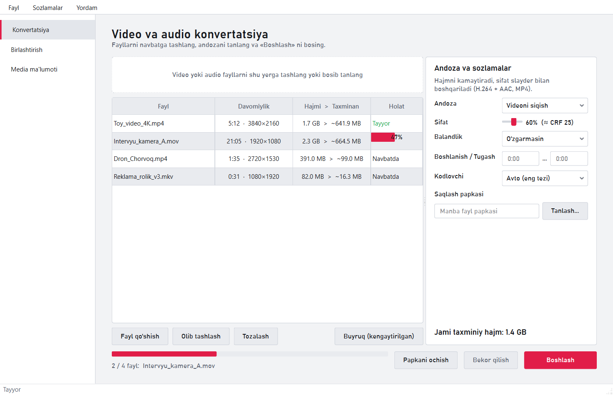
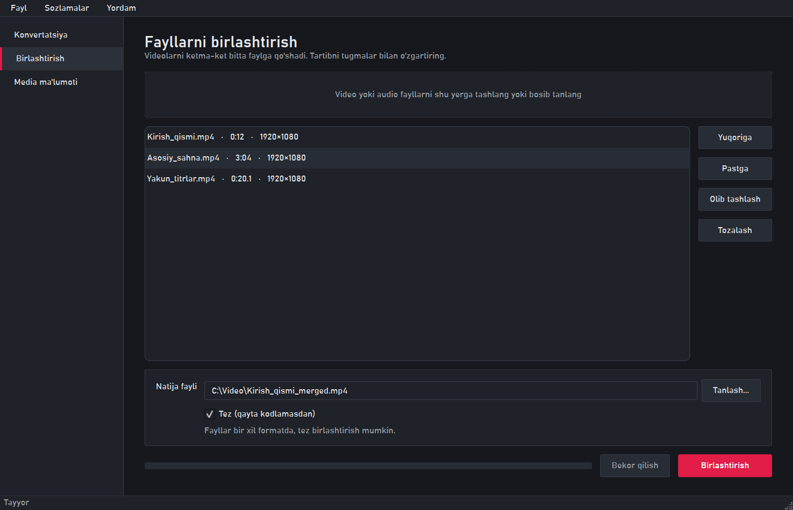
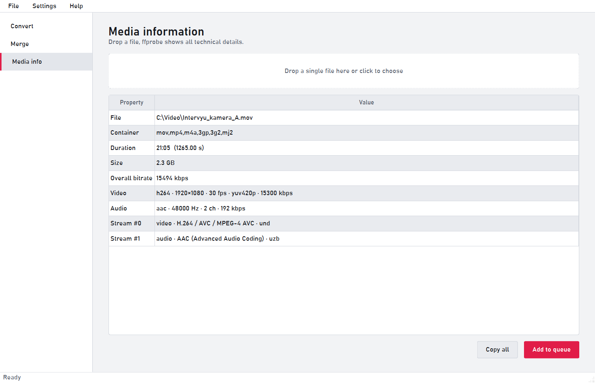

UDK: 004.42:004.932

# FFmpeg uchun andozalarga asoslangan grafik qobiq: video va audio fayllarni oflayn konvertatsiya qilish, hajmni oldindan baholash va apparat kodlovchilardan foydalanish

**Hakimov Bahtiyorjon**  
*[ish joyi, lavozimi, elektron pochta]*

**Annotatsiya.** Maqolada FFmpeg dasturi uchun ishlab chiqilgan “FFmpeg qobig‘i” grafik interfeysli dasturi tavsiflanadi. Dastur video va audio fayllar bilan ishlashning keng tarqalgan vazifalarini o‘n uchta tayyor andoza ko‘rinishida taqdim etadi: videoni siqish, Telegram, Instagram Reels, YouTube va WhatsApp uchun tayyorlash, formatni o‘zgartirish, ovozni ajratish, GIF yasash, kesish, o‘lchamni o‘zgartirish, burish, ovozni olib tashlash va kadrlarni rasmga olish. Fayllar navbat orqali qayta ishlanadi, har bir fayl uchun jarayon foizi va chiqish faylining taxminiy hajmi ko‘rsatiladi. Dastur apparat H.264 kodlovchilarni avtomatik aniqlaydi, videolarni birlashtiradi, ffprobe ma’lumotlarini ko‘rsatadi va kengaytirilgan rejimda buyruqni tahrirlash imkonini beradi. Arxitektura, hisoblash modellari va testlar yoritiladi.

*Kalit so‘zlar:* FFmpeg, video konvertatsiya, grafik interfeys, andoza, H.264, apparat kodlovchi, oflayn dastur.

**Графическая оболочка FFmpeg на основе пресетов: офлайн-конвертация видео- и аудиофайлов, предварительная оценка размера и использование аппаратных кодировщиков**

**Аннотация.** В статье описывается программа «FFmpeg qobig‘i» («Оболочка FFmpeg») с графическим интерфейсом для FFmpeg. Программа представляет распространённые задачи работы с видео и аудио в виде тринадцати готовых пресетов: сжатие видео, подготовка для Telegram, Instagram Reels, YouTube и WhatsApp, смена формата, извлечение звука, создание GIF, обрезка, изменение размера, поворот, удаление звука и сохранение кадров в изображения. Файлы обрабатываются через очередь, для каждого файла отображаются процент выполнения и ориентировочный размер результата. Программа автоматически определяет аппаратные кодировщики H.264, объединяет видео, показывает сведения ffprobe и в расширенном режиме позволяет редактировать команду. Рассматриваются архитектура, расчётные модели и тесты.

*Ключевые слова:* FFmpeg, конвертация видео, графический интерфейс, пресет, H.264, аппаратный кодировщик, офлайн-приложение.

**A preset-based graphical shell for FFmpeg: offline conversion of video and audio files, output size estimation and use of hardware encoders**

**Abstract.** The paper describes “FFmpeg qobig‘i” (FFmpeg Shell), a graphical application built on top of FFmpeg. The program offers common video and audio tasks as thirteen ready-made presets: video compression, preparation for Telegram, Instagram Reels, YouTube and WhatsApp, container change, audio extraction, GIF creation, trimming, resizing, rotation, audio removal and saving frames as images. Files are processed through a queue, and progress and the estimated output size are shown for each file. The program automatically detects hardware H.264 encoders, merges videos, displays ffprobe information and, in an advanced mode, allows the generated command to be edited. The architecture, calculation models and tests are discussed.

*Keywords:* FFmpeg, video conversion, graphical interface, preset, H.264, hardware encoder, offline application.

## Kirish

Video va audio materiallar bilan ishlash bugungi kunda faqat mutaxassislarning vazifasi emas. O‘qituvchi dars yozuvini masofaviy ta’lim platformasiga joylashtirishi, talaba loyiha videosini ijtimoiy tarmoqqa tayyorlashi, tashkilot xodimi tadbir yozuvini messenjer orqali yuborishi, jurnalist intervyudan ovozni ajratib olishi kerak bo‘ladi. Bu vazifalarning har birida fayl ma’lum platforma talablariga – hajm, o‘lcham, kadr chastotasi, kodek va formatga – moslashtirilishi lozim.

Raqamli media bilan ishlash sohasida FFmpeg loyihasi keng qo‘llanadigan ochiq vositalardan biri hisoblanadi. U deyarli barcha video va audio formatlarini o‘qish, yozish va o‘zgartirish imkonini beradi. Biroq FFmpeg buyruq satri orqali boshqariladi: oddiy foydalanuvchi uchun kodek nomlari, bitreyt, filtrlar zanjiri va parametrlar sintaksisini bilish talab qilinadi. Bitta noto‘g‘ri belgi butun buyruqning ishlamasligiga olib keladi, natija hajmini oldindan bilish esa hisob-kitobni talab qiladi.

Ko‘plab foydalanuvchilar bu muammoni onlayn konvertorlar orqali hal qiladi. Ammo bu yo‘l katta hajmdagi videolarni tarmoqqa yuklashni, internet aloqasining tezligiga bog‘liqlikni va shaxsiy yoki xizmat materiallarini uchinchi tomonga berishni anglatadi. “Raqamli O‘zbekiston – 2030” strategiyasida raqamli kontent yaratish va ta’limni raqamlashtirish vazifalari belgilangan; bu vazifalarni bajarishda mahalliy kompyuterda ishlaydigan, foydalanish oson vositalar zarur.

Tadqiqotning maqsadi – FFmpeg imkoniyatlarini oddiy foydalanuvchi uchun tushunarli andozalar, navbat va hajmni oldindan baholash bilan taqdim etuvchi, o‘zbek tilidagi interfeysga ega oflayn grafik qobiqni ishlab chiqish va uning hisoblash modellarini asoslash. Bu maqsadga erishish uchun quyidagi vazifalar hal qilindi: ko‘p uchraydigan vazifalarni andozalarga ajratish; har bir andoza uchun FFmpeg buyrug‘ini avtomatik tuzish; chiqish hajmini baholash modelini yaratish; apparat kodlovchilarni aniqlash va zaxira variantini ta’minlash; jarayonni kuzatish va bekor qilish; manba fayllarni himoya qilish; avtomatik testlar bilan tekshirish.

Maqolaning amaliy yangiligi shundaki, unda FFmpeg imkoniyatlari mahalliy foydalanuvchilar ko‘p qo‘llaydigan platformalar (Telegram, WhatsApp, Instagram, YouTube) talablariga yo‘naltirilgan andozalar ko‘rinishida tashkil etilgan, natija hajmi esa kodlashdan oldin taxminiy model asosida ko‘rsatiladi. Bu foydalanuvchiga “natija platformaga sig‘adimi” degan savolga ish boshlanishidan oldin javob olish imkonini beradi.

## Muammoning qo‘yilishi va mavjud yechimlar tahlili

Video konvertatsiya vositalarini bir necha guruhga ajratish mumkin. Birinchi guruh – brauzer orqali ishlaydigan onlayn konvertorlar. Ular o‘rnatishni talab qilmaydi, lekin fayl hajmi bo‘yicha cheklovlarga ega bo‘lishi, faylni tashqi serverga yuklashni talab qilishi va natijani yuklab olish uchun qo‘shimcha vaqt sarflashi mumkin.

Ikkinchi guruh – ko‘p funksiyali ish stoli video konvertorlari va video muharrirlar. Ularning bir qismi keng imkoniyatlarga ega, lekin interfeysi murakkab yoki pullik; ba’zilari esa o‘rnatish jarayonida qo‘shimcha dasturlarni taklif qiladi. Uchinchi guruh – FFmpeg dasturini to‘g‘ridan-to‘g‘ri buyruq satrida ishlatish. Bu eng moslashuvchan yo‘l, ammo u mutaxassislik bilimini talab qiladi.

Tahlil asosida ishlab chiqiladigan dasturga quyidagi talablar qo‘yildi:

- barcha amallar internetsiz bajarilishi, FFmpeg va FFprobe dastur bilan birga yetkazilishi;
- ko‘p uchraydigan vazifalarning platformalar talablariga mos tayyor andozalar ko‘rinishida taqdim etilishi;
- bir nechta faylni navbat orqali qayta ishlash, har bir fayl uchun jarayon foizi va holatni ko‘rsatish;
- natija faylining taxminiy hajmini ish boshlanishidan oldin ko‘rsatish;
- kompyuterda mavjud apparat kodlovchilardan foydalanish va ular ishlamasa, dasturiy kodlovchiga o‘tish;
- manba fayllar va mavjud natijalar ustiga yozmaslik;
- tajribali foydalanuvchi uchun tuzilgan buyruqni ko‘rish va tahrirlash imkoniyati;
- o‘zbek, rus va ingliz tillaridagi interfeys.

## Tadqiqot metodologiyasi va dasturiy arxitektura

Dastur Python 3.12 tilida yozilgan, grafik interfeysi PySide6 (Qt 6) asosida qurilgan. Media fayllarni qayta ishlash uchun FFmpeg, ularning texnik ma’lumotlarini o‘qish uchun FFprobe ishlatiladi; ikkala dastur LGPL litsenziyali yig‘ma ko‘rinishida dastur bilan birga tarqatiladi. Dastur PyInstaller yordamida yig‘iladi va portativ ZIP arxiv ko‘rinishida tarqatiladi.

Dastur paketi quyidagi modullardan iborat:

- **ffbin** – FFmpeg va FFprobe fayllarini topish, kompyuterda ishlaydigan H.264 kodlovchilarni aniqlash;
- **media** – FFprobe chiqishini (JSON) tahlil qilib, davomiylik, o‘lcham, kadr chastotasi, bitreyt, kodek, audio parametrlari va burilish ma’lumotini olish;
- **presets** – andozalar, vaqtni tahlil qilish, chiqish yo‘lini tanlash, video parametrlarini rejalashtirish, FFmpeg buyruqlarini tuzish, birlashtirish buyruqlari va hajmni baholash;
- **runner** – FFmpeg jarayonini ishga tushirish, jarayon haqidagi chiqishdan foizni o‘qish va bekor qilish;
- **window** – asosiy oyna va uning uch sahifasi: “Konvertatsiya”, “Birlashtirish”, “Media ma’lumoti”;
- **strings** – uch tildagi interfeys matnlari.
Arxitekturaning muhim tamoyili – buyruq tuzish mantig‘ining interfeysdan to‘liq ajratilganligi. Presets moduli kirish sifatida vazifa tavsifi (andoza va uning parametrlari) va media ma’lumotini qabul qilib, bajariladigan buyruqlar ro‘yxatini qaytaradi. Shu tufayli har bir andoza grafik interfeyssiz, avtomatik testlarda tekshiriladi.

**Sifat modeli.** Foydalanuvchi sifatni 0 dan 100 gacha foizlarda belgilaydi. Bu qiymat x264 kodlovchisining CRF shkalasiga mos qiymatga chiziqli o‘tkaziladi: 0% – CRF 35, 100% – CRF 18. Masalan, 60% sifat taxminan CRF 25 ga to‘g‘ri keladi va interfeysda “60% (≈ CRF 25)” ko‘rinishida ko‘rsatiladi. Dastur turli kodlovchilar bilan ishlagani sababli kodlash CRF bo‘yicha emas, bitreyt bo‘yicha boshqariladi. Bitreyt piksel uchun bitlar soni modeli asosida hisoblanadi: CRF 23 da bir piksel uchun taxminan 0,085 bit qabul qilinadi va CRF har 6 birlikka oshganda bitreyt ikki baravar kamayadi. Video bitreyti kenglik, balandlik, kadr chastotasi (60 dan oshmagan holda) va piksel uchun bitlar ko‘paytmasidan topiladi, eng kichik qiymat 150 kbit/s bilan cheklanadi.

**Andozalarga xos cheklovlar.** “Videoni siqish” andozasida video bitreyti manba video bitreytining 85 foizidan oshmaydi, ya’ni siqish natijasi manbadan katta bo‘lmasligi ko‘zda tutilgan. “Telegram uchun” andozasida tasvir balandligi 1080 piksel bilan cheklanadi, bitreyt esa natija 2 GB chegarasining 97 foizidan oshmaydigan qilib davomiylik asosida hisoblanadi. “WhatsApp uchun” andozasi 720 piksel balandlik, 30 kadr/s va 2000 kbit/s chegaralarini qo‘llaydi. “Instagram Reels” andozasi 1080×1920 vertikal kadr va 30 kadr/s, “YouTube 1080p” esa 1920×1080 kadr va 192 kbit/s audio bilan ishlaydi. Reels uchun gorizontal video uch usulda joylanadi: xira fon bilan, qora hoshiya bilan yoki kesib to‘ldirish orqali.

**Hajmni baholash.** Har bir fayl uchun chiqish hajmi kodlashdan oldin hisoblanadi. Video andozalarda hajm video va audio bitreytlari yig‘indisini davomiylikka ko‘paytirish va konteyner xarajati uchun kichik qo‘shimcha qo‘shish orqali topiladi. Ovozni ajratishda audio bitreyti (WAV uchun namuna chastotasi va kanallar soni asosida), qayta kodlamasdan bajariladigan amallarda manba hajmining tanlangan qismga mos ulushi, GIF va kadrlarni olishda esa piksellar soni va kadrlar soni asosidagi taxminiy koeffitsiyentlar ishlatiladi. Natija jadvalning “Taxminan” ustunida va “Jami taxminiy hajm” qatorida ko‘rsatiladi. Bu qiymat taxminiy ekanligi interfeysda “~” belgisi bilan ta’kidlanadi.

**Kodlovchini tanlash.** Dastur kompyuterda H.264 kodlovchilarini quyidagi tartibda sinab ko‘radi: NVIDIA NVENC, AMD AMF, Intel Quick Sync, Windows Media Foundation va dasturiy OpenH264. Har bir kodlovchi qisqa sinov kodlashi orqali tekshiriladi, natija keshda saqlanadi. “Avto (eng tezi)” rejimida birinchi ishlaydigan kodlovchi tanlanadi; buyruq xato bilan tugasa, dastur dasturiy kodlovchi bilan zaxira buyruqni bajaradi. WEBM formati uchun VP9, AVI uchun MPEG-4 kodlovchilari ishlatiladi.

**Jarayonni kuzatish.** FFmpeg jarayon haqidagi ma’lumotni standart chiqishga kalit-qiymat ko‘rinishida yozadigan rejimda ishga tushiriladi. Runner moduli bu qatorlardan joriy vaqtni o‘qib, uni davomiylikka nisbatan foizga aylantiradi. Jarayon alohida oqimda bajariladi va istalgan paytda to‘xtatilishi mumkin.

**Xavfsizlik.** Chiqish fayli nomi manba nomiga andoza qo‘shimchasi qo‘shish orqali hosil qilinadi; bunday fayl mavjud bo‘lsa, nomga qavs ichida tartib raqami qo‘shiladi, ya’ni hech bir mavjud fayl ustiga yozilmaydi. Birlashtirishda natija fayli kiruvchi fayllardan biri bilan bir xil bo‘lsa, amal rad etiladi. Dastur tarmoqqa murojaat qilmaydi, sozlamalar foydalanuvchining %APPDATA% papkasida saqlanadi.

**Media ma’lumotlarini o‘qish.** Har bir fayl navbatga qo‘shilganda FFprobe orqali uning konteyner va oqimlar haqidagi ma’lumoti JSON ko‘rinishida olinadi. Media moduli bu ma’lumotdan davomiylik, umumiy va video bitreyt, kenglik va balandlik, kadr chastotasi, audio namuna chastotasi va kanallar soni, shuningdek videoning burilish metama’lumotini ajratadi. Burilish hisobga olinishi muhim: telefon kamerasida vertikal suratga olingan video ko‘pincha gorizontal kadr va 90° burilish belgisi bilan saqlanadi, shuning uchun ko‘rsatiladigan o‘lcham burilishni inobatga olgan holda hisoblanadi.

**Vaqtni tahlil qilish.** Boshlanish va tugash vaqtlari soniyalarda (“90”), daqiqa va soniyada (“1:30”) yoki to‘liq ko‘rinishda (“00:01:30.5”) kiritilishi mumkin. Tahlilchi noto‘g‘ri yozuvni rad etadi, tugash vaqti boshlanishdan katta bo‘lishini va boshlanish vaqti fayl davomiyligidan oshmasligini tekshiradi. Effektiv davomiylik (tanlangan bo‘lak uzunligi) jarayon foizi va hajm baholashda ishlatiladi.

**Kadrlarni olish.** “Kadrlarni rasmga olish” andozasida FFmpeg kadr chastotasi filtri har N soniyada bitta kadr qoldiradigan qilib sozlanadi, rasmlar esa manba nomi va besh xonali tartib raqami bilan alohida papkaga yoziladi. Olinadigan kadrlar soni davomiylik va interval asosida oldindan hisoblanadi.

## Amalga oshirish va asosiy funksiyalar

Asosiy oyna chap tomonda uch bandli navigatsiya paneli va o‘ng tomonda tanlangan sahifadan iborat.

**Konvertatsiya sahifasi** (“Video va audio konvertatsiya”) fayllarni sudrab tashlash maydoni, navbat jadvali va “Andoza va sozlamalar” kartochkasidan iborat. Jadvalda “Fayl”, “Davomiylik”, “O‘lcham”, “Hajmi”, “Taxminan”, “Jarayon” va “Holat” ma’lumotlari ko‘rsatiladi. Kartochkada andoza tavsifi, “Andoza” ro‘yxati va tanlangan andozaga mos parametrlar chiqadi: “Sifat” slayderi, “Balandlik”, “Joylash” usuli, “Format”, “Tez (qayta kodlamasdan)” belgisi, “Bitreyt”, GIF uchun “Kadr/s” va “Kenglik (px)”, burish “Amal”i, “Har N soniyada” va “Rasm formati”, “Boshlanish / Tugash” vaqtlari, “Kodlovchi” va “Saqlash papkasi”. Har bir andoza uchun faqat unga tegishli parametrlar ko‘rsatiladi.

O‘n uchta andoza quyidagilardan iborat: “Videoni siqish”, “Telegram uchun”, “Instagram Reels (1080×1920)”, “YouTube 1080p”, “WhatsApp uchun”, “Formatni o‘zgartirish” (MP4, MKV, MOV, WEBM, AVI; “Tez” rejimda qayta kodlamasdan), “Ovozni ajratib olish” (MP3, AAC (M4A) yoki WAV), “GIF yasash” (sifatli palitra bilan), “Kesib olish”, “O‘lchamni o‘zgartirish” (proporsiya saqlanadi), “Burish / aks ettirish” (90° soat yo‘nalishida yoki teskari, 180°, gorizontal yoki vertikal aks), “Ovozni olib tashlash” (video qayta kodlanmaydi) va “Kadrlarni rasmga olish” (har N soniyada JPG yoki PNG). GIF yasashda ikki bosqichli palitra usuli qo‘llanadi: avval video kadrlari bo‘yicha optimal palitra hosil qilinadi, so‘ng tasvir shu palitra bilan aralashtirish (dithering) usulida GIF ga aylantiriladi.

Navbatdagi fayllar ketma-ket qayta ishlanadi: pastki qismda umumiy jarayon chizig‘i va “2 / 4 fayl” ko‘rinishidagi hisoblagich, jadvalda esa har bir faylning foizi va holati (“Navbatda”, “Bajarilmoqda”, “Tayyor”, “Xato”, “Bekor qilindi”) ko‘rsatiladi. Yakunda muvaffaqiyatli va xato bilan tugagan fayllar soni haqida xabar chiqadi.

**Kengaytirilgan rejim.** “Buyruq (kengaytirilgan)” tugmasi navbatda tanlangan fayl uchun tuzilgan FFmpeg buyrug‘ini oynada ko‘rsatadi. Foydalanuvchi uni tahrirlab, “Shu faylga qo‘llash” tugmasi bilan faqat shu fayl uchun ishlatishi yoki “Asl holiga qaytarish” mumkin. Bunday fayl jadvalda “Qo‘lda buyruq” holati bilan belgilanadi. Bu rejim FFmpeg dasturini o‘rganuvchilar uchun ham foydali: andoza qanday buyruqqa aylanishini ko‘rish mumkin.

**Birlashtirish sahifasi** (“Fayllarni birlashtirish”) videolarni ketma-ket bitta faylga qo‘shadi. Fayllar tartibi “Yuqoriga” va “Pastga” tugmalari bilan o‘zgartiriladi. Dastur fayllarning kodek, o‘lcham va audio parametrlarini solishtirib, tez birlashtirish mumkinligini aniqlaydi: mos kelsa, FFmpeg dasturining concat demultipleksori orqali qayta kodlamasdan birlashtiriladi (“Fayllar bir xil formatda, tez birlashtirish mumkin.”), aks holda barcha bo‘laklar bir xil o‘lcham va kadr chastotasiga keltirilib, filtr orqali qayta kodlanadi.

**Media ma’lumoti sahifasi** faylning konteyneri, davomiyligi, hajmi, umumiy bitreyti, video va audio oqimlari parametrlari hamda har bir oqim haqidagi ma’lumotni FFprobe yordamida jadval ko‘rinishida ko‘rsatadi. “Hammasini nusxalash” tugmasi ma’lumotni almashish buferiga ko‘chiradi, “Navbatga qo‘shish” esa faylni konvertatsiya navbatiga yuboradi.

**Sozlamalarni saqlash.** Foydalanuvchi tanlagan andoza va uning parametrlari, saqlash papkasi va kodlovchi tanlovi sozlamalar faylida saqlanadi va keyingi ishga tushirishda tiklanadi. Shu tufayli muntazam bir xil vazifani bajaruvchi foydalanuvchi (masalan, har hafta dars yozuvlarini siquvchi o‘qituvchi) sozlamalarni har safar qayta tanlamaydi.

**Xato holatlarini qayta ishlash.** Navbatdagi fayl uchun andoza talab qiladigan oqim bo‘lmasa (masalan, audio fayldan GIF yasash yoki ovozsiz videodan ovoz ajratish), fayl “Xato” holatini oladi va tushunarli sabab ko‘rsatiladi, navbatning qolgan qismi esa davom etadi. Chiqish papkasini yaratib bo‘lmasa yoki boshqa jiddiy xato yuz bersa, foydalanuvchiga aniq xabar beriladi.

*1-rasm. “Konvertatsiya” sahifasi: to‘rt fayldan iborat navbat, “Videoni siqish” andozasi, 60% sifat (≈ CRF 25), taxminiy hajmlar va jarayon*

*2-rasm. Qorong‘i mavzudagi “Birlashtirish” sahifasi: uchta video, natija fayli va “Tez (qayta kodlamasdan)” rejimi*

*3-rasm. “Media ma’lumoti” sahifasi: ffprobe orqali olingan konteyner, davomiylik, bitreyt va oqimlar ma’lumoti*

## Sinov va natijalar

Dastur pytest freymvorkida yozilgan avtomatik testlar bilan tekshiriladi. Tests papkasidagi to‘rtta faylda jami 26 ta test funksiyasi mavjud, ularning bir qismi parametrlangan.

- Andozalar testlari (18 ta funksiya): vaqtni turli ko‘rinishlarda o‘qish va davomiylikni formatlash, sifat va CRF o‘rtasidagi bog‘liqlikning monotonligi, proporsiyani saqlagan holda o‘lchamni hisoblash, chiqish yo‘li mavjud faylni qayta yozmasligi, Telegram uchun natija 2 GB dan oshmasligi, siqishda bitreyt manbadan katta bo‘lmasligi, Reels uchun xira fon filtri, kesish parametrlari va davomiylik, burish va zaxira kodlovchi, videosiz faylda xato, birlashtirish ro‘yxati va moslikni tekshirish, hajmni baholash, jarayon qatorlarini o‘qish, FFprobe ma’lumotidan burilishni aniqlash, shuningdek haqiqiy FFmpeg bilan bir nechta andoza bo‘yicha kodlash, kadrlarni olish va birlashtirish hamda jarayonni bekor qilish.
- Chuqur ssenariy testlari (4 ta funksiya): andozalarning noto‘g‘ri kiruvchi ma’lumotlardan himoyasi, birlashtirishda kiruvchi faylni qayta yozmaslik, bekor qilish va yaratib bo‘lmaydigan chiqish papkasi, shikastlangan sozlamalar fayli.
- Interfeys testlari (2 ta funksiya): navbatga fayl qo‘shib, ovozni ajratish va siqishni bajarish; noto‘g‘ri vaqt kiritilganda dasturning ishdan chiqmasligi.
- Tutun testlari (2 ta funksiya): asosiy oynaning yaratilishi va tarjimalarning uch tilda to‘liqligi.
Dastur o‘n uchta andozani, besh xil konteyner formatini (MP4, MKV, MOV, WEBM, AVI), uch xil audio formatni (MP3, AAC, WAV), GIF va JPG/PNG kadrlarni qo‘llab-quvvatlaydi. Interfeys o‘zbek, rus va ingliz tillarida, dastur Windows 10 (1809+) va Windows 11 uchun mo‘ljallangan.

Haqiqiy kodlash testlari test davomida FFmpeg yordamida yaratilgan qisqa namunaviy video ustida bajariladi va bir nechta andoza bilan olingan natija fayllari mavjudligi va o‘qilishi tekshiriladi. FFmpeg topilmagan muhitda bunday testlar o‘tkazib yuboriladi, buyruq tuzish va hisoblash modellari testlari esa tashqi dasturga bog‘liq emas.

Mazkur ishda kodlash tezligi va hajmni baholash aniqligi bo‘yicha miqdoriy o‘lchovlar o‘tkazilmagan; hajm baholash modeli taxminiy xarakterga ega bo‘lib, uning aniqligini turli video turlarida empirik tekshirish keyingi tadqiqotlar vazifasidir.

## Muhokama

Dasturning asosiy afzalligi – FFmpeg dasturining kuchli imkoniyatlarini vazifaga yo‘naltirilgan andozalar orqali taqdim etishi. Foydalanuvchi kodek va bitreyt haqida o‘ylamasdan “Telegram uchun” yoki “Instagram Reels” andozasini tanlaydi, dastur esa platforma cheklovlarini (hajm, o‘lcham, kadr chastotasi) avtomatik hisobga oladi. Hajmni oldindan baholash foydalanuvchiga natija talablarga mos kelishini kodlashdan oldin ko‘rish imkonini beradi.

Ikkinchi afzallik – kompyuter imkoniyatlaridan samarali foydalanish va ishonchlilik. Apparat kodlovchilarni sinov orqali aniqlash nazariy jihatdan mavjud, ammo amalda ishlamaydigan kodlovchini tanlash xavfini kamaytiradi, dasturiy kodlovchiga o‘tish esa natijaning har qanday kompyuterda olinishini ta’minlaydi.

Uchinchi afzallik – o‘rganish uchun shaffoflik. Kengaytirilgan rejimda buyruqni ko‘rish va tahrirlash dasturni FFmpeg dasturini o‘rganish vositasiga aylantiradi: foydalanuvchi andoza tanlab, tegishli buyruq tarkibini tahlil qilishi mumkin.

Hajmni baholash modelining tanlanishi ham asoslangan: piksel uchun bitlar soniga asoslangan model kodlovchidan mustaqil va hisoblash uchun arzon, shuning uchun u foydalanuvchi har bir sozlamani o‘zgartirganda darhol qayta hisoblanishi mumkin. Bitreyt bo‘yicha kodlash esa natija hajmini sifat bo‘yicha kodlashga (CRF) nisbatan oldindan aytib berish osonroq bo‘lgan rejim hisoblanadi; bu xususiyat platformaning hajm chegarasiga rioya qilish talab etiladigan andozalarda ayniqsa muhim.

Cheklovlar: andozalar to‘plami belgilangan va foydalanuvchi o‘z andozasini saqlay olmaydi; H.264 kodlashda bitreyt boshqaruvi qo‘llanadi, shuning uchun sifat turli sahnalarda o‘zgarishi mumkin; hajm baholash taxminiy; dasturda vaqt shkalasi bo‘yicha vizual montaj, subtitr qo‘shish yoki rang tuzatish kabi muharrir funksiyalari yo‘q. HEVC va AV1 kabi yangi kodeklar andozalarda ishlatilmaydi.

Rivojlantirish istiqbollari: foydalanuvchi andozalarini saqlash, HEVC va AV1 kodeklarini qo‘shish, ikki o‘tishli kodlash orqali hajm aniqligini oshirish, vaqt shkalasi bo‘yicha kesish uchun oldindan ko‘rish.

Umuman olganda, taklif etilgan yondashuvni “murakkab vositaga vazifaga yo‘naltirilgan kirish nuqtasi” sifatida tavsiflash mumkin: foydalanuvchi o‘z vazifasini tanlaydi, dastur esa uni texnik parametrlarga aylantiradi, kerak bo‘lganda esa bu parametrlarni ochiq ko‘rsatadi.

## Xulosa

Maqolada FFmpeg uchun andozalarga asoslangan grafik qobiq – “FFmpeg qobig‘i” dasturi taqdim etildi. Dastur o‘n uchta andoza, fayllar navbati, jarayonni kuzatish va bekor qilish, chiqish hajmini oldindan baholash, apparat kodlovchilarni avtomatik aniqlash, videolarni birlashtirish, media ma’lumotini ko‘rish va buyruqni tahrirlash imkoniyatlarini birlashtiradi. Sifatni CRF shkalasiga va piksel uchun bitlar modeliga bog‘lash, platforma cheklovlarini bitreyt hisobida inobatga olish va mavjud fayllar ustiga yozmaslik dasturning asosiy texnik yechimlari hisoblanadi. Dastur 26 ta avtomatik test funksiyasi bilan, shu jumladan haqiqiy FFmpeg bilan kodlash sinovlari orqali tekshiriladi.

Ishning amaliy ahamiyati – buyruq satri bilan ishlash tajribasi bo‘lmagan foydalanuvchiga professional darajadagi media vositasidan xavfsiz va tushunarli tarzda foydalanish imkonini berishda, ilmiy-uslubiy ahamiyati esa platforma cheklovlarini hisobga oluvchi andozalar va hajmni oldindan baholash yondashuvini taklif etishda ko‘rinadi.

Dastur o‘qituvchilar, talabalar, media va jurnalistika yo‘nalishi mutaxassislari hamda tashkilot xodimlari uchun video materiallarni platformalarga tayyorlash vositasi sifatida, shuningdek multimedia texnologiyalari fanlarida kodek, bitreyt va konteyner tushunchalarini amaliy o‘rgatish uchun qo‘llanishi mumkin.

## Foydalanilgan adabiyotlar

1. O‘zbekiston Respublikasi Prezidentining 2020-yil 5-oktabrdagi PF-6079-son “Raqamli O‘zbekiston – 2030” strategiyasini tasdiqlash va uni samarali amalga oshirish chora-tadbirlari to‘g‘risida”gi Farmoni.
2. FFmpeg Documentation [Elektron resurs]. – URL: https://ffmpeg.org/documentation.html (murojaat sanasi: 27.11.2026).
3. FFmpeg Filters Documentation [Elektron resurs]. – URL: https://ffmpeg.org/ffmpeg-filters.html (murojaat sanasi: 27.11.2026).
4. ffprobe Documentation [Elektron resurs]. – URL: https://ffmpeg.org/ffprobe.html (murojaat sanasi: 27.11.2026).
5. ITU-T Recommendation H.264. Advanced video coding for generic audiovisual services [Elektron resurs]. – URL: https://www.itu.int/rec/T-REC-H.264 (murojaat sanasi: 27.11.2026).
6. Cisco Systems. OpenH264 [Elektron resurs]. – URL: https://www.openh264.org/ (murojaat sanasi: 27.11.2026).
7. Python Software Foundation. Python 3.12 Documentation [Elektron resurs]. – URL: https://docs.python.org/3.12/ (murojaat sanasi: 27.11.2026).
8. The Qt Company. Qt for Python (PySide6) Documentation [Elektron resurs]. – URL: https://doc.qt.io/qtforpython-6/ (murojaat sanasi: 27.11.2026).
9. PyInstaller Development Team. PyInstaller Manual [Elektron resurs]. – URL: https://pyinstaller.org/en/stable/ (murojaat sanasi: 27.11.2026).
10. Hakimov B. FFmpeg qobig‘i: dastur manba kodi va tavsifi [Elektron resurs]. – URL: https://github.com/eduhakimov/video-konvertor (murojaat sanasi: 27.11.2026).
