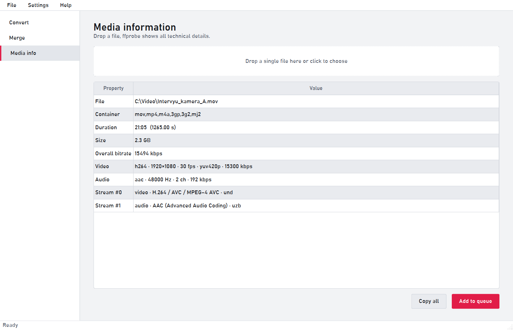

# FFmpeg qobig‘i: Uslubiy ko‘rsatma

Muallif: Hakimov Bahtiyorjon. Versiya: 1.0.2.

## 1. Uslubiy ko‘rsatmaning maqsadi va vazifalari

Mazkur uslubiy ko‘rsatma “FFmpeg qobig‘i” dasturidan oliy ta’lim muassasalari, kollej va texnikumlarda o‘quv mashg‘ulotlari o‘tkazishda hamda tashkilotlarda video materiallar bilan ishlashda foydalanish tartibini belgilaydi.

Maqsad – tinglovchilarda raqamli video va audioning asosiy parametrlari (konteyner, kodek, o‘lcham, kadr chastotasi, bitreyt) haqida tushuncha hosil qilish hamda materiallarni turli platformalar talablariga mos tayyorlash ko‘nikmalarini shakllantirish.

Vazifalar:

- konteyner va kodek tushunchalarining farqini tushuntirish;
- bitreyt, o‘lcham va davomiylik bilan fayl hajmi o‘rtasidagi bog‘liqlikni ko‘rsatish;
- sifat va hajm o‘rtasidagi muvozanatni tanlashni o‘rgatish;
- platformalar (messenjerlar, ijtimoiy tarmoqlar, video xostinglar) talablariga mos fayl tayyorlash ko‘nikmasini shakllantirish;
- qayta kodlash va qayta kodlamasdan ishlov berish farqini tushuntirish;
- FFmpeg buyrug‘ining tuzilishi bilan tanishtirish;
- mualliflik huquqi va shaxsiy ma’lumotlarga hurmat madaniyatini rivojlantirish.
Mashg‘ulot uchun Windows 10 yoki 11 o‘rnatilgan kompyuterlar va o‘qituvchi tayyorlagan 2–3 ta qisqa (1–2 daqiqalik) namunaviy video kerak. Internet talab qilinmaydi.

Mashg‘ulot yakunida tinglovchi bilishi kerak: konteyner, kodek, bitreyt, o‘lcham va kadr chastotasi tushunchalari, fayl hajmini taxminiy hisoblash usuli, qayta kodlash va nusxalash farqi, asosiy platformalar talablari. Tinglovchi bajara olishi kerak: media fayl parametrlarini aniqlash, videoni kerakli hajm va sifatda siqish, uni platformaga moslab tayyorlash, ovozni ajratish, GIF yasash, videolarni birlashtirish va natijani tekshirish.

## 2. Qo‘llash sohasi va maqsadli auditoriya

Dasturdan quyidagi fanlar va kurslarda foydalanish tavsiya etiladi: “Multimedia texnologiyalari”, “Kompyuter grafikasi va video montaj”, “Raqamli media”, “Jurnalistika va media texnologiyalari”, “Informatika va axborot texnologiyalari”, “Masofaviy ta’lim texnologiyalari”, “Ma’lumotlarni siqish usullari”.

Maqsadli auditoriya:

- multimedia, dizayn, jurnalistika va axborot texnologiyalari yo‘nalishlari talabalari va o‘quvchilari;
- video ma’ruza va o‘quv materiallari tayyorlaydigan professor-o‘qituvchilar;
- tashkilotlarning matbuot xizmati va ijtimoiy tarmoqlar bilan ishlovchi xodimlari;
- buyruq satri vositalarini o‘rganayotgan informatika talabalari (kengaytirilgan rejim orqali).
Kasbiy vazifalardan misollar: dars yozuvini masofaviy ta’lim platformasiga yuklash uchun siqish, tadbir videosini Telegram yoki WhatsApp orqali yuborish uchun tayyorlash, gorizontal videodan Instagram Reels uchun vertikal variant yaratish, intervyudan ovozni MP3 ko‘rinishida ajratish, taqdimot uchun qisqa GIF tayyorlash, videodan illyustratsiya uchun kadrlar olish.

Informatika yo‘nalishidagi tinglovchilar uchun dastur qo‘shimcha o‘quv qiymatiga ega: kengaytirilgan rejimda har bir andoza qanday buyruqqa aylanishini ko‘rish mumkin. Bu buyruq satri vositalari, parametrlar sintaksisi va filtrlar zanjiri kabi tushunchalarni grafik interfeys bilan bog‘lab o‘rganishga imkon beradi. Shuningdek, sifatning CRF shkalasiga o‘tkazilishi va hajmni baholash formulasi ma’lumotlarni siqish nazariyasi mavzulari uchun amaliy misol bo‘la oladi.

Masofaviy ta’lim sharoitida dastur o‘qituvchilarga katta hajmli dars yozuvlarini platformaga yuklash uchun tez tayyorlash, talabalarga esa sekin internet orqali ham yuklab olinadigan kichik hajmli variantlarni yaratish imkonini beradi. Bu raqamli o‘quv materiallaridan foydalanish imkoniyatini kengaytiradi.

## 3. O‘quv mashg‘ulotida foydalanish tartibi

80 daqiqalik amaliy mashg‘ulot rejasi:

1. **Tashkiliy qism (5 daqiqa).** Davomat, mavzu va maqsadni e’lon qilish, kompyuterlar va namunaviy videolar tayyorligini tekshirish.
2. **Nazariy qism (20 daqiqa).** Raqamli video tuzilishi: konteyner (MP4, MKV, WEBM) va kodek (H.264, VP9, AAC) farqi. Bitreyt va fayl hajmi: hajm ≈ (video bitreyti + audio bitreyti) × davomiylik. O‘lcham va kadr chastotasining ta’siri. Qayta kodlash va oqimni nusxalash. Apparat va dasturiy kodlovchilar. Platforma talablari. Dastur oynasi va andozalar bilan tanishtirish. O‘qituvchi “Media ma’lumoti” sahifasida namunaviy video parametrlarini ko‘rsatib, tushunchalarni aniq misolda izohlaydi.
3. **Amaliy qism (45 daqiqa).** Tinglovchilar “Amaliy topshiriqlar” bo‘limidagi 1–6-topshiriqlarni bajaradi: media ma’lumotini tahlil qiladi, videoni turli sifatda siqadi, platformalar uchun tayyorlaydi, ovozni ajratadi, GIF yasaydi va videolarni birlashtiradi.
4. **Yakuniy qism (10 daqiqa).** Natijalarni muhokama qilish: taxminiy va haqiqiy hajmni solishtirish, sifatdagi farqlarni baholash. Nazorat savollari, baholash, mustaqil ish topshirig‘i.
Kodlash vaqt talab qilishini hisobga olib, amaliy qismda qisqa videolardan foydalanish va jarayon davom etayotganda tinglovchilarga “Buyruq (kengaytirilgan)” oynasida buyruq tarkibini tahlil qilish topshirig‘ini berish tavsiya etiladi.

Nazariy qismda o‘qituvchi hajm formulasini doskada misol bilan hisoblab ko‘rsatishi tavsiya etiladi: masalan, 2000 kbit/s video va 128 kbit/s audio bitreytli 60 soniyalik video taxminan (2000 + 128) × 60 / 8 ≈ 16 MB hajmga ega bo‘ladi. So‘ngra shu natija dasturdagi “Taxminan” ustuni bilan solishtiriladi. Bu usul nazariy formulani amaliy natija bilan bog‘laydi.

Amaliy qismni juftlikda tashkil etish mumkin: bir tinglovchi kodlashni bajaradi, ikkinchisi “Media ma’lumoti” orqali natija parametrlarini tekshiradi va jadvalga yozadi.

Mashg‘ulot natijasi sifatida har bir tinglovchi siqilgan, platformaga moslangan va birlashtirilgan video fayllar hamda media parametrlari va hajmlar yozilgan jadvalni topshiradi.

*1-rasm. Nazariy qismda tushunchalarni izohlash uchun ishlatiladigan “Media ma’lumoti” sahifasi*

## 4. Amaliy topshiriqlar

Topshiriqlar murakkablik darajasi ortib borish tartibida joylashtirilgan. Har bir topshiriqdan keyin tinglovchi natija faylini “Media ma’lumoti” sahifasida ochib, uning parametrlarini tekshiradi. Namunaviy videolar sifatida mualliflik huquqi cheklovlari bo‘lmagan, o‘qituvchi tayyorlagan materiallardan foydalaniladi.

1. **Media ma’lumotini tahlil qilish.** Namunaviy videoni “Media ma’lumoti” sahifasida oching va uning konteyneri, kodeklari, o‘lchami, kadr chastotasi va bitreytini daftarga yozing. Kutilgan natija: to‘ldirilgan parametrlar jadvali va har bir parametr nimani bildirishining izohi.
2. **Sifat va hajm.** Bitta videoni “Videoni siqish” andozasida 30%, 60% va 90% sifat bilan siqing. Kutilgan natija: uchta fayl; tinglovchi taxminiy va haqiqiy hajmlarni solishtiradi va tasvir sifatidagi farqni tavsiflaydi.
3. **Platformalar uchun tayyorlash.** Shu videoni “Telegram uchun” va “WhatsApp uchun” andozalarida tayyorlang. Kutilgan natija: ikki fayl; tinglovchi ularning o‘lchami va hajmidagi farqni “Media ma’lumoti” orqali tekshirib, sababini izohlaydi.
4. **Vertikal video.** Gorizontal videodan “Instagram Reels (1080×1920)” andozasi bilan uchta variant yarating: “Xira fon bilan”, “Qora hoshiya”, “Kesib to‘ldirish”. Kutilgan natija: uchta vertikal video va ularning afzalliklari haqida qisqa xulosa.
5. **Ovoz va GIF.** Videodan ovozni MP3 formatida ajrating, so‘ng 5 soniyalik bo‘lakdan GIF yasang. Kutilgan natija: MP3 fayl va GIF fayl; manba video o‘zgarmagan.
6. **Birlashtirish.** Bir xil formatdagi ikki videoni “Tez (qayta kodlamasdan)” rejimida birlashtiring, so‘ng formati har xil bo‘lgan ikki videoni birlashtiring. Kutilgan natija: ikki birlashtirilgan fayl; tinglovchi ikkinchi holatda nima uchun qayta kodlash zarurligini tushuntiradi.
7. **Kesish va burish.** Videodan 0:10 dan 0:25 gacha bo‘lgan qismni kesib oling, so‘ng uni 90° soat yo‘nalishida buring. Kutilgan natija: 15 soniyalik burilgan video.
8. **Buyruq tahlili.** “Buyruq (kengaytirilgan)” orqali “Videoni siqish” andozasi tuzgan buyruqni ko‘chirib oling va undagi har bir parametrning vazifasini FFmpeg hujjatlari yordamida izohlang. Kutilgan natija: izohlangan buyruq matni.
Vaqt yetmagan hollarda 7–8-topshiriqlar mustaqil ish sifatida uyga beriladi va keyingi mashg‘ulotda tekshiriladi.

## 5. Baholash mezonlari

Baholash amaliy ish natijalari, ularning tahlili va nazorat savollariga javoblar asosida amalga oshiriladi.

Amaliy ish 100 ballik tizimda baholanadi:

- media parametrlarini to‘g‘ri aniqlash va izohlash – 15 ball;
- siqish va sifat bo‘yicha tajriba, natijalarni solishtirish – 20 ball;
- platformalar uchun fayllarni to‘g‘ri tayyorlash – 20 ball;
- ovozni ajratish, GIF va birlashtirish topshiriqlari – 15 ball;
- natijalarning tahlili va xulosalar (hajm, sifat, vaqt) – 15 ball;
- nazorat savollariga javoblar – 15 ball.
Baho: 86–100 ball – “a’lo”, 71–85 – “yaxshi”, 55–70 – “qoniqarli”, 55 dan kam – “qoniqarsiz”. 7–8-topshiriqlar uchun qo‘shimcha rag‘batlantiruvchi ballar berilishi mumkin.

Baholashda natija fayllarining o‘zi bilan birga tinglovchining tanlovlarini asoslay olishi (nima uchun aynan shu andoza va sifat tanlangani) muhim hisoblanadi. Ballar jurnalda qayd etiladi.

## 6. Nazorat savollari

Savollar og‘zaki so‘rov yoki qisqa yozma nazorat uchun mo‘ljallangan. Har bir to‘liq va asoslangan javob uchun 1,5 ball beriladi.

1. Konteyner va kodek o‘rtasidagi farq nimada? Misollar keltiring.
2. Video fayl hajmi qaysi parametrlarga bog‘liq?
3. Bitreyt nima va u sifatga qanday ta’sir qiladi?
4. Qayta kodlash va oqimni nusxalash (“Tez” rejim) farqi nimada?
5. Nima uchun ba’zi videolarni tez birlashtirib bo‘lmaydi?
6. Apparat kodlovchining afzalligi nimada?
7. Instagram Reels uchun gorizontal videoni joylashning qanday usullari bor?
8. Dastur Telegram uchun tayyorlashda hajmni qanday cheklaydi?
9. Taxminiy hajm haqiqiy hajmdan nima uchun farq qilishi mumkin?
10. Boshqa muallif videosini qayta ishlash va tarqatishda qanday qoidalarga rioya qilish kerak?
Savollarga javob berishda tinglovchi o‘z amaliy natijalaridan misollar keltirishi tavsiya etiladi.

## 7. Mustaqil ish uchun tavsiyalar

- O‘zingiz telefonda yozgan 1–2 daqiqalik videoni uchta platforma (Telegram, WhatsApp, YouTube) uchun tayyorlang va natijalar parametrlarini jadvalga yozing.
- Turli turdagi videolar (statik ma’ruza, harakatli sport sahnasi) uchun bir xil sifat sozlamasida siqish natijalarini solishtiring va harakat darajasi hajm va sifatga qanday ta’sir qilishi haqida xulosa yozing.
- Ovozni MP3, AAC va WAV formatlarida ajratib, hajmlarni solishtiring va siqilgan hamda siqilmagan audio formatlari farqini tushuntiring.
- FFmpeg rasmiy hujjatlaridan foydalanib, dasturdagi biror andoza buyrug‘ini mustaqil tahlil qiling va 1 sahifali izoh tayyorlang.
- Mustaqil ish natijalarini keyingi mashg‘ulotda qisqa chiqish shaklida taqdim eting.
- Dasturning “Kesib olish” andozasini “Tez” rejimda va qayta kodlash bilan bajarib, natijalarni davomiylik va kesish aniqligi bo‘yicha solishtiring; farqning sababini tayanch kadr tushunchasi orqali tushuntiring.
- “Kadrlarni rasmga olish” andozasi yordamida o‘quv videosidan har 10 soniyada kadr olib, ulardan mavzu bo‘yicha qisqa vizual konspekt (taqdimot yoki hujjat) tayyorlang.
- Bir xil videoni “Formatni o‘zgartirish” andozasida MP4 va WEBM formatlariga o‘tkazib, kodlash vaqti va hajmini solishtiring hamda natijalarni qisqa jadvalda ifodalang.

## 8. Xavfsizlik va axborot madaniyati qoidalari

- Boshqa mualliflarning videolarini ruxsatsiz qayta ishlamang va tarqatmang; mualliflik huquqini hurmat qiling.
- Videoda boshqa shaxslar tasvirlangan bo‘lsa, ularning roziligisiz videoni ijtimoiy tarmoqlarga joylamang.
- Shaxsiy va xizmat videolarini onlayn konvertorlarga yuklamang; oflayn vositalardan foydalaning.
- Kengaytirilgan rejimda buyruqni tahrirlaganda chiqish fayli nomiga e’tibor bering: buyruqdagi o‘zgarishlar natijaga bevosita ta’sir qiladi.
- Diskda bo‘sh joy yetarli ekanini tekshiring: katta videolarni kodlashda natija fayllari ko‘p joy egallaydi.
- Kompyuter sinfida ishlash va texnika xavfsizligi qoidalariga rioya qiling; mashg‘ulot yakunida o‘quv kompyuteridagi shaxsiy videolaringizni o‘chiring.
- Dasturni faqat rasmiy GitHub sahifasidan yuklab oling.
- Natija fayllarini nomlashda tushunarli nomlardan foydalaning va asl videolarning zaxira nusxasini saqlang.
- Kodlash jarayonida kompyuter qizib ketishi va ventilyator kuchliroq ishlashi tabiiy holat; noutbukda uzoq kodlashni elektr tarmog‘iga ulangan holda bajaring.
